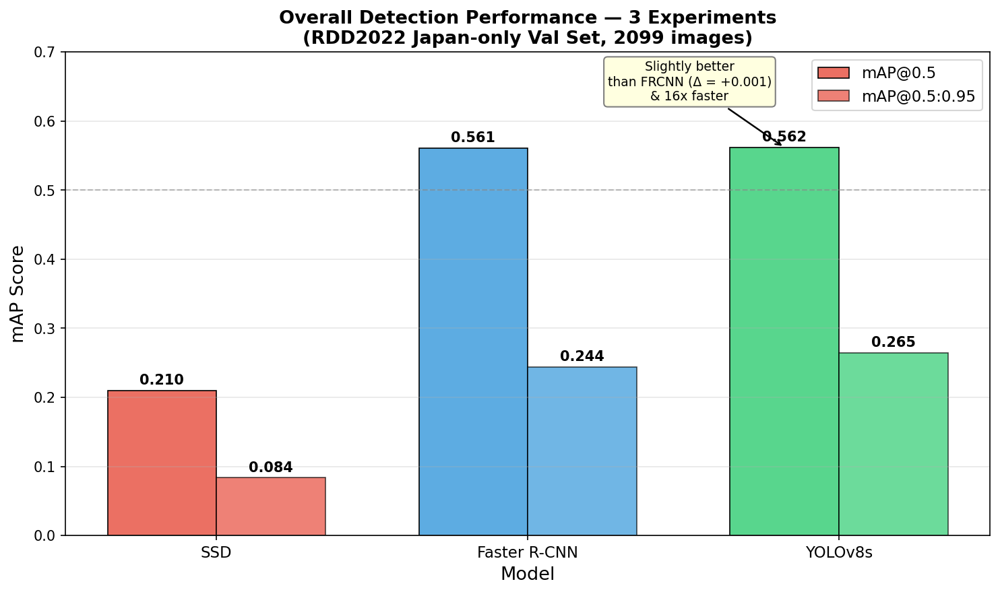
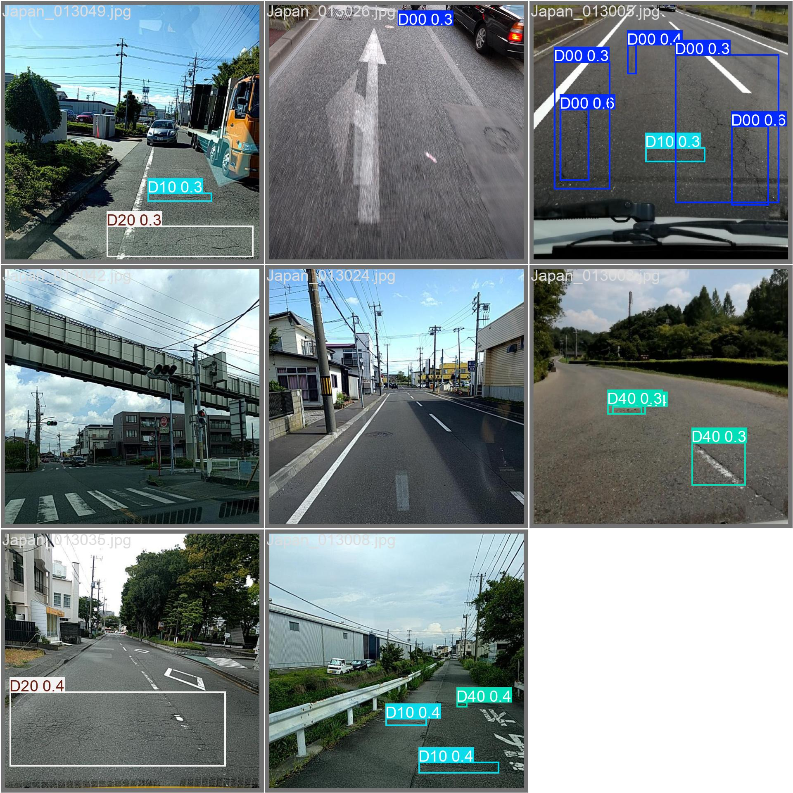

# Road Damage Detection Source Code & Results

**ITCS352 Introduction to Deep Learning** · Faculty of ICT, Mahidol University · 2026

A coursework project comparing **SSD, Faster R-CNN, and YOLOv8s** for detecting four
types of road damage in the **RDD2022 Japan subset**. The final YOLOv8s model is
included with a Gradio demo for images, video, and webcam inference.

**Team:** Perawis Buranasing (6688012) · Atichat Kangsamut (6688193)

[Report](docs/report-gr6.pdf) · [Presentation](docs/presentation-slide-gr6.pdf) ·
[Docker demo](docker/README.md) · [EDA notebook](notebooks/phase2_eda.ipynb) ·
[Dataset & large files](docs/ASSETS.md)

## Overview

The project covers dataset inspection, exploratory data analysis, Pascal VOC XML
conversion, train/validation splitting, model training, evaluation, and a local demo.
Successive experiments examine detection accuracy, localization, per-class AP, and
the trade-off between accuracy and inference speed.

| Class | Damage type |
| --- | --- |
| D00 | Longitudinal crack |
| D10 | Transverse crack |
| D20 | Alligator crack |
| D40 | Pothole |

## Reported results

Metrics below are from the submitted report on the **Japan validation split**.
They are historical experiment results, not new measurements from this upload.

| Experiment | Model | Input | mAP@0.5 | mAP@0.5:0.95 | Inference time |
| --- | --- | --- | ---: | ---: | ---: |
| Baseline | SSDLite MobileNetV3 | 320 px | 0.210 | 0.084 | ~12 ms/image |
| Experiment 2 | Faster R-CNN ResNet-50 FPN | 800 px | 0.561 | 0.244 | ~175 ms/image |
| Run A | YOLOv8s | 640 px | 0.556 | 0.258 | ~7.7 ms/image |
| **Run B (selected)** | **YOLOv8s** | **832 px** | **0.562** | **0.265** | **~11 ms/image** |

Reported hardware: NVIDIA RTX 4060 Laptop GPU (8 GB VRAM), Ubuntu 22.04 under WSL2.
Inference time depends on the hardware and execution settings.





### Findings and limitations

- Faster R-CNN improved detection over the SSD baseline; YOLOv8s achieved similar
  accuracy with lower reported inference latency.
- Run B increased resolution from 640 to 832 pixels; batch size also changed from
  16 to 8 to fit GPU memory. This is a resolution comparison with a batch-size
  confound, rather than a strictly single-variable experiment.
- The report gives D10 AP@0.5 as 0.439 for Run A and 0.461 for Run B. Thin cracks
  remain difficult; the model was trained and validated on Japan-only data.
- Per-class AP for SSD and Faster R-CNN was not recorded correctly in the original
  runs. Zero values in the archived per-class plots indicate missing measurements,
  rather than measured zero detection performance.
- `src/phase8_figures.py` uses manually entered experiment summaries. Some parameter
  counts and SSD timing annotations differ from the report; the table above follows
  the report and the original artifacts are retained.

## Repository structure

```text
road-damage-detection/
  config/             Central dataset and output paths
  src/                Inspection, preparation, training, analysis, and Gradio app
  notebooks/          EDA notebook with original outputs
  outputs/
    figures/          EDA, SSD analysis, and model comparison charts
    runs/             Saved metrics, prediction images, TensorBoard logs, best weights
  docker/             Standalone CPU demo, Docker configuration, and final best.pt
  docs/               Report, slides, dataset reference, and packaging notes
  requirements.txt    Training/analysis dependency list
```

Duplicate wrapper directories in the supplied assets (`docker/docker` and
`outputs/outputs`) have been flattened to match the source code's expected paths.

## Try the demo

### Docker

```bash
git clone https://github.com/atichatz/road-damage-detection.git
cd road-damage-detection/docker
docker compose up --build
```

Open **http://localhost:7860**. See [Docker instructions](docker/README.md) for details.
The final weights are included; the dataset is not required for this demo.

### Local Python environment

Use **Python 3.10**, matching the original project. Create and activate an isolated
environment, then install PyTorch and torchvision for your hardware. A CPU example:

```bash
python -m pip install torch==2.2.2 torchvision==0.17.2 --index-url https://download.pytorch.org/whl/cpu
python -m pip install -r requirements.txt
python src/phase8/demo.py
```

Open **http://localhost:7860**. Install ffmpeg separately for H.264 video re-encoding.
The original GPU experiments used a CUDA-enabled PyTorch environment; choose the
appropriate CUDA build when reproducing them. The dependency list is not an exact
lockfile of the original training environment.

## Dataset and training

The dataset is downloaded separately. See [dataset instructions](docs/ASSETS.md),
including the original RDD2022 link supplied with the coursework.

1. Put the extracted raw dataset at `data/raw/RDD2022/`, or edit `DATA_RAW` in
   `config/paths.py`.
2. Set `DATA_PROC` in `config/paths.py` to the desired processed Japan dataset path.
   Its original default is `Path.home() / "data" / "japan_only"`.
3. Run inspection and preparation from the repository root:

```bash
python src/phase1_inspect.py
python src/phase3_prepare_data.py
```

The report describes an 80/20 split with seed 42: **8,407 training images** and
**2,099 validation images**. The four supported labels are retained and other label
codes are filtered; background-only images are retained.

Run the training and analysis stages as needed:

```bash
python src/phase4_train_ssd.py
python src/phase5_ssd_analysis.py
python src/phase6_train_fasterrcnn.py
python src/phase7_train_yolov8s.py
python src/phase7b_yolov8s_runB.py
python src/phase8_figures.py
```

For an existing processed dataset moved from another computer, inspect the paths in
`manifest.json` and `dataset.yaml`; `python src/fix_data_configs.py` can update them
after `DATA_PROC` is configured. The script makes backups before changing existing files.

Training creates new timestamped run directories. The supplied demo and some
analysis scripts select the original run names; update those selections when using
newly trained checkpoints.

## Explore saved results

- Browse [comparison figures](outputs/figures/phase8_comparison) and
  [prediction artifacts](outputs/runs) directly without training.
- Open `notebooks/phase2_eda.ipynb` to inspect the original exploratory analysis.
- View logs locally:

```bash
tensorboard --logdir outputs/runs
```

The full dataset, large Faster R-CNN checkpoints, last-epoch YOLO weights, and
generated Python caches are not included in Git. See [asset inventory](docs/ASSETS.md)
for exact omissions and the original download link.

## Provenance and validation

This repository combines the source submission `6_6688012_6688193` with the supplied
`road-damage-det` Docker and result assets. Training code and saved experiment results
are preserved. Packaging adds documentation, a dependency list, ignore rules, and
removes trailing NUL bytes from the copied Docker dependency reference.

Python syntax, notebook structure, internal documentation links, and file-size limits
were checked during packaging. Training, inference, and the Docker build were not
rerun; reported metrics remain those of the original coursework.

The [original submission README](docs/original-submission-README.md) is preserved for
reference. It describes the submission archive rather than this GitHub layout.
No new reuse license is assigned; third-party libraries, pretrained weights, and
dataset assets retain their respective terms.
